# Inventory Management System

A RESTful backend application for managing products, tracking inventory, handling stock operations, and generating inventory reports.

**Tech Stack:** Node.js · Express.js · MongoDB · Mongoose

---

## 1. Project Overview

The **Inventory Management System** is a backend application developed as part of **Assignment 3 – Web Development III (Unit 3)**.

The project provides RESTful APIs to perform essential inventory management operations, including product creation, updating, deletion, stock management, product filtering, searching, sorting, and report generation.

It uses MongoDB for data storage and Mongoose for database modeling, schema validation, and data management.

## 2. Technology Stack

| Technology | Description |
|---|---|
| Node.js | JavaScript runtime environment |
| Express.js | Backend framework for building REST APIs |
| MongoDB | NoSQL database for storing product information |
| Mongoose | Object Data Modeling (ODM) library |
| dotenv | Environment variable management |
| Postman | API development and testing |

## 3. Key Features

- Complete CRUD operations for product management.
- Product validation using Mongoose schemas.
- Unique SKU validation to prevent duplicate product entries.
- Product search by name.
- Filtering by category and price range.
- Sorting and pagination of product records.
- Stock replenishment through restock operations.
- Sales management with stock quantity updates.
- Prevention of negative inventory during sales.
- Low-stock product reporting.
- Category-wise inventory summaries.
- Centralized error handling with JSON responses.

## 4. Project Structure

```text
inventory-management-system/
│
├── config/
├── controllers/
├── middleware/
├── models/
├── routes/
├── screenshots/
│
├── .gitignore
├── package.json
├── package-lock.json
├── server.js
└── README.md
```

## 5. Installation and Setup

### Prerequisites

Make sure the following are installed:

- Node.js (version 18 or later)
- MongoDB (local installation or MongoDB Atlas)
- npm
- Postman (for API testing)

### Step 1: Clone the Repository

```bash
git clone https://github.com/aradhana-bit/inventory-management-system.git
cd inventory-management-system
```

### Step 2: Install Dependencies

```bash
npm install
```

### Step 3: Configure Environment Variables

Create a `.env` file in the root directory and add:

```env
PORT=5000
MONGODB_URI=mongodb://127.0.0.1:27017/inventory_management
LOW_STOCK_THRESHOLD=5
```

For MongoDB Atlas, replace the local MongoDB URI with your Atlas connection string.

### Step 4: Start the Server

```bash
npm run dev
```

Once the server starts successfully, the API will be accessible at:

```text
http://localhost:5000
```

## 6. Product Schema

The application uses a Mongoose schema to define and validate product information.

| Field | Description |
|---|---|
| `name` | Required product name (2–100 characters) |
| `description` | Optional product description (maximum 500 characters) |
| `category` | Required product category |
| `price` | Required numeric value (minimum 0) |
| `quantity` | Required non-negative whole number |
| `sku` | Required unique SKU, stored in uppercase |
| `supplier` | Optional supplier name |
| `createdAt` | Automatically generated creation timestamp |
| `updatedAt` | Automatically generated update timestamp |

## 7. API Documentation

The application provides the following REST API endpoints.

### 7.1 Product Management

| HTTP Method | Endpoint | Functionality |
|---|---|---|
| POST | `/api/products` | Create a new product |
| GET | `/api/products` | Retrieve all products |
| GET | `/api/products/:id` | Retrieve a product by ID |
| PUT | `/api/products/:id` | Update product information |
| DELETE | `/api/products/:id` | Delete a product |
| PATCH | `/api/products/:id/restock` | Increase available stock |
| PATCH | `/api/products/:id/sale` | Record a sale and decrease stock |

### 7.2 Inventory Reports

| HTTP Method | Endpoint | Functionality |
|---|---|---|
| GET | `/api/reports/low-stock` | Retrieve products with low stock |
| GET | `/api/reports/category-summary` | Generate category-wise inventory statistics |

## 8. API Request Examples

### 8.1 Create a Product

**POST** `/api/products`

```json
{
  "name": "Wireless Mouse",
  "description": "2.4 GHz wireless mouse",
  "category": "Accessories",
  "price": 799,
  "quantity": 12,
  "sku": "ACC-MOU-001",
  "supplier": "Tech Supplies"
}
```

### 8.2 Update a Product

**PUT** `/api/products/PRODUCT_ID`

```json
{
  "price": 849,
  "description": "Updated product description"
}
```

### 8.3 Restock a Product

**PATCH** `/api/products/PRODUCT_ID/restock`

```json
{
  "quantity": 10
}
```

### 8.4 Record a Sale

**PATCH** `/api/products/PRODUCT_ID/sale`

```json
{
  "quantity": 2
}
```

The sale operation uses a conditional database update to ensure that the available stock does not become negative.

## 9. Search, Filtering, Sorting and Pagination

The product API supports additional query parameters to make product retrieval more flexible.

| Operation | Example Request |
|---|---|
| Get all products | `GET /api/products` |
| Get product by ID | `GET /api/products/PRODUCT_ID` |
| Filter by category | `GET /api/products?category=Accessories` |
| Search by name | `GET /api/products?search=wireless` |
| Filter by price | `GET /api/products?minPrice=200&maxPrice=2000` |
| Sort by price | `GET /api/products?sort=price&order=asc` |
| Paginate results | `GET /api/products?page=1&limit=5` |
| Low-stock report | `GET /api/reports/low-stock?threshold=10` |
| Category summary | `GET /api/reports/category-summary` |

**Supported sorting fields:**

`name`, `price`, `quantity`, `category`, `createdAt`

**Supported sorting orders:**

`asc` – Ascending order

`desc` – Descending order

The default low-stock threshold is configured through `LOW_STOCK_THRESHOLD`, with a fallback value of `5`.

The category summary provides:
- Total number of products.
- Total available stock units.
- Total inventory value.
- Average product price.

## 10. Postman API Testing

All major API operations were tested using Postman to verify the functionality of the application and validate the server responses.

### 10.1 Product Management

| Test Case | Screenshot |
|---|---|
| **01 – Create Product** | 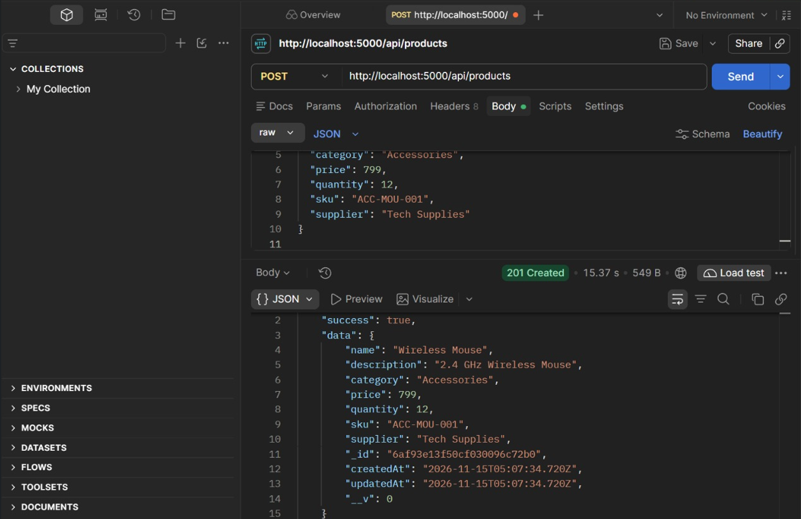 |
| **02 – Get All Products** | 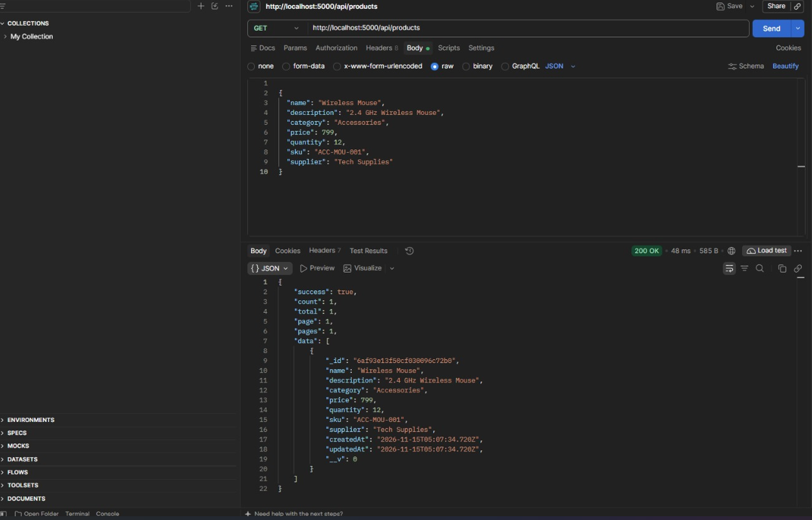 |
| **03 – Get Product by ID** | 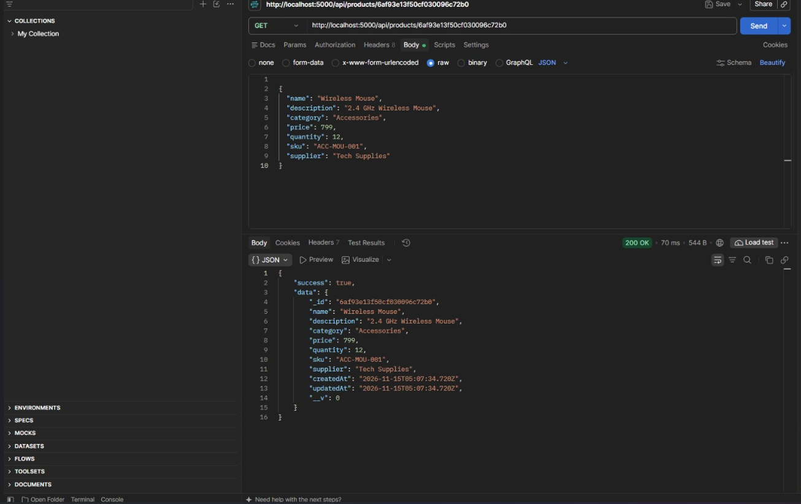 |
| **04 – Update Product** | 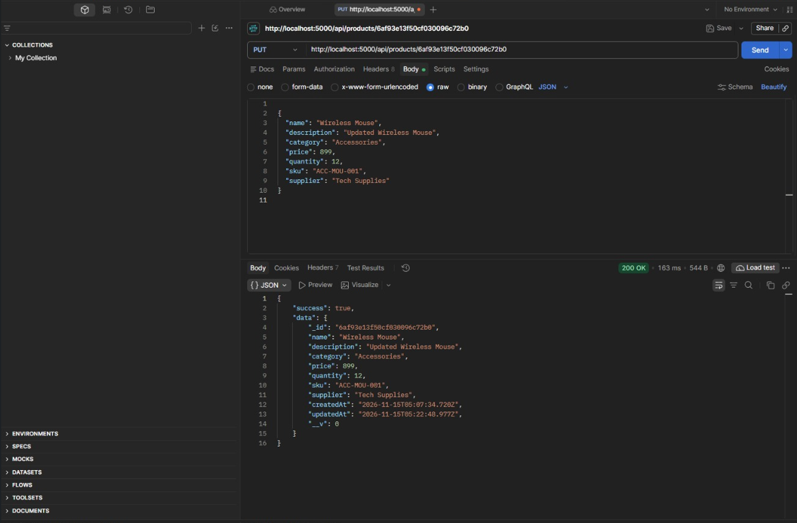 |
| **05 – Restock Product** | 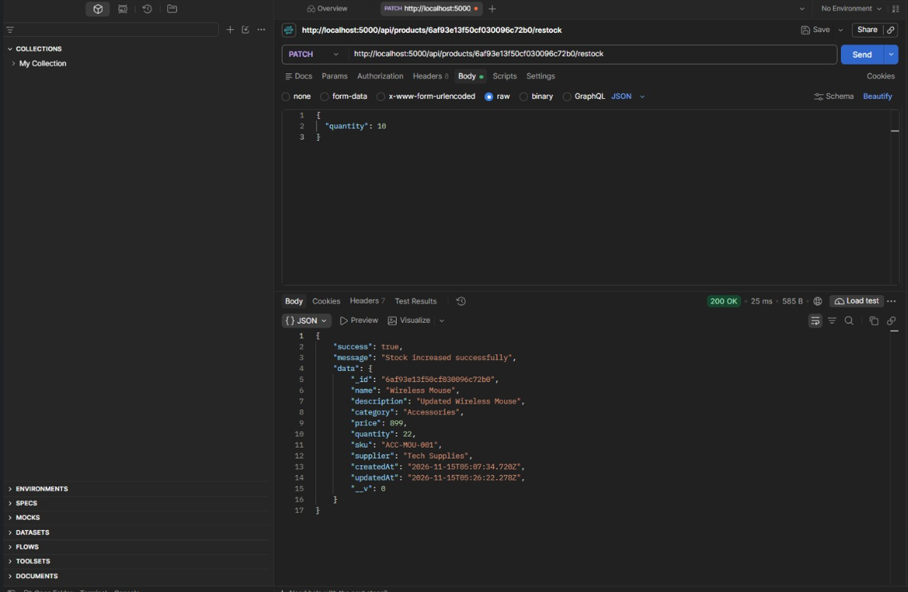 |
| **06 – Record a Sale** | 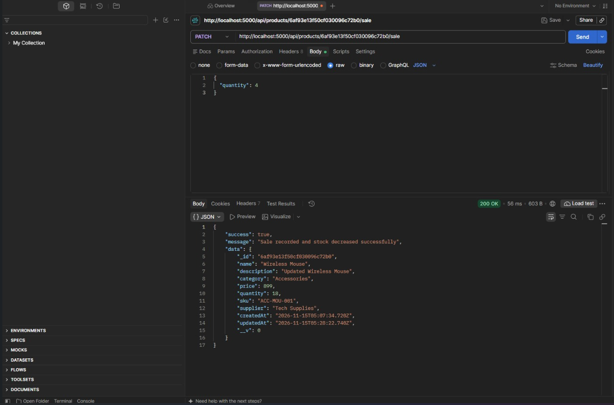 |
| **07 – Delete Product** | 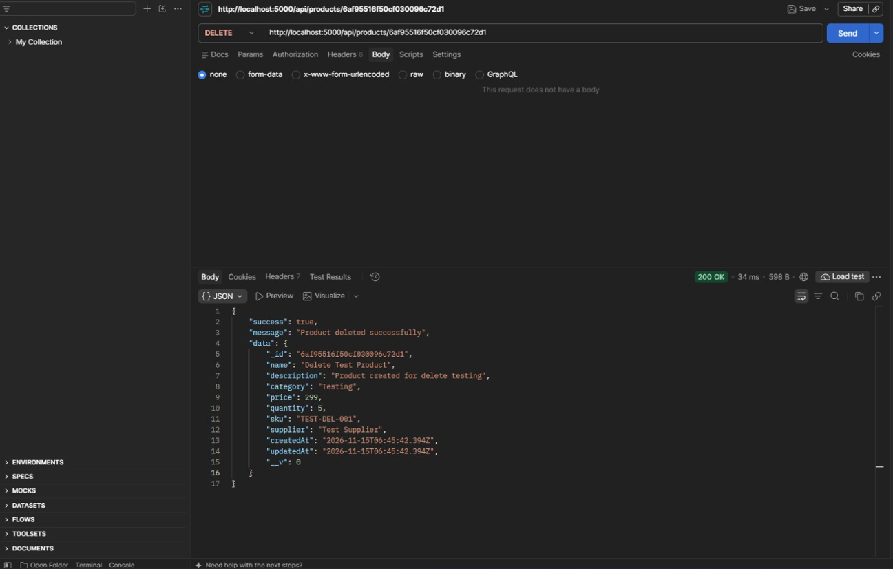 |
| **08 – Low-Stock Report** | 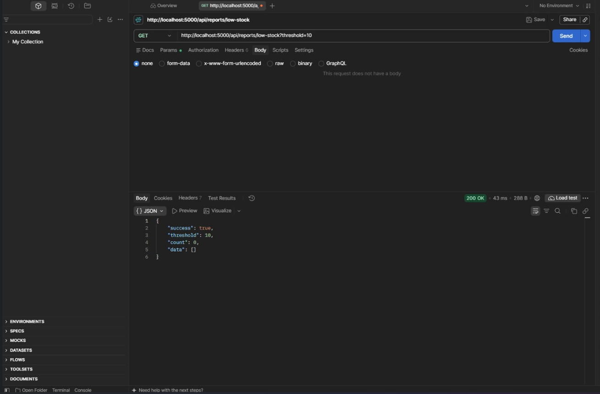 |

### 10.2 Reports, Filters and Validation

| Test Case | Screenshot |
|---|---|
| **09 – Category Summary** | 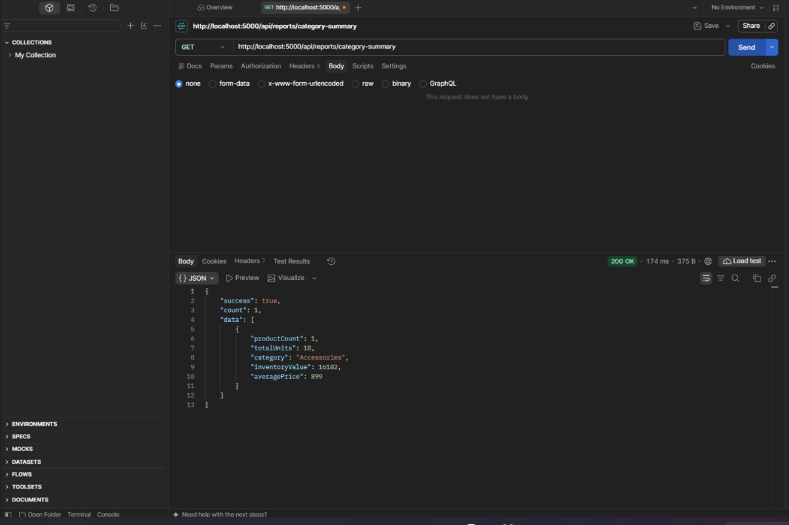 |
| **10 – Category Filtering** | 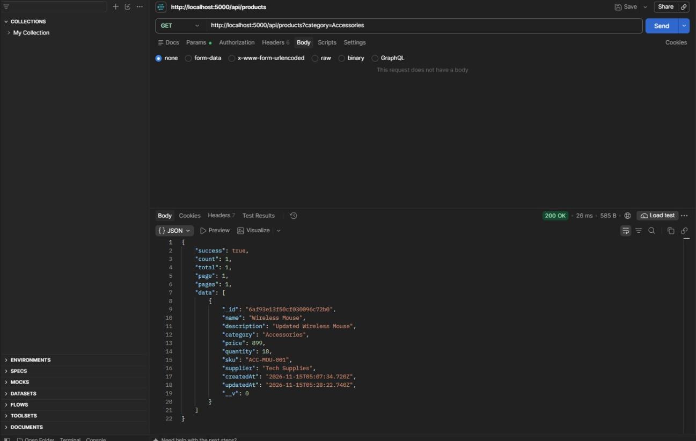 |
| **11 – Product Search** | 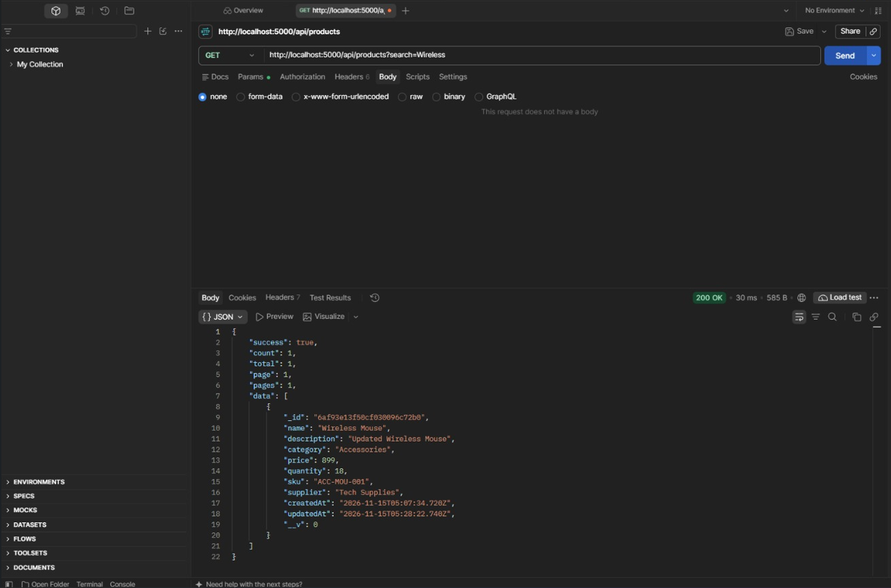 |
| **12 – Price Filtering** | 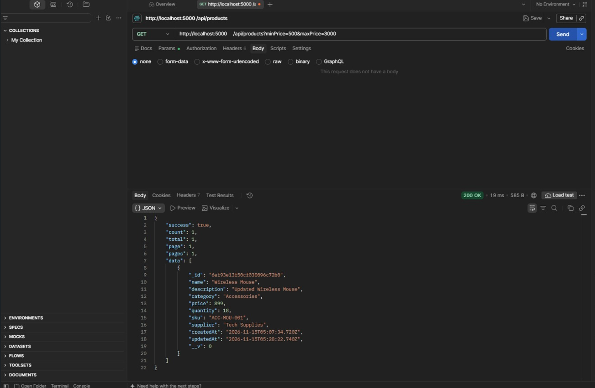 |
| **13 – Sorting** | 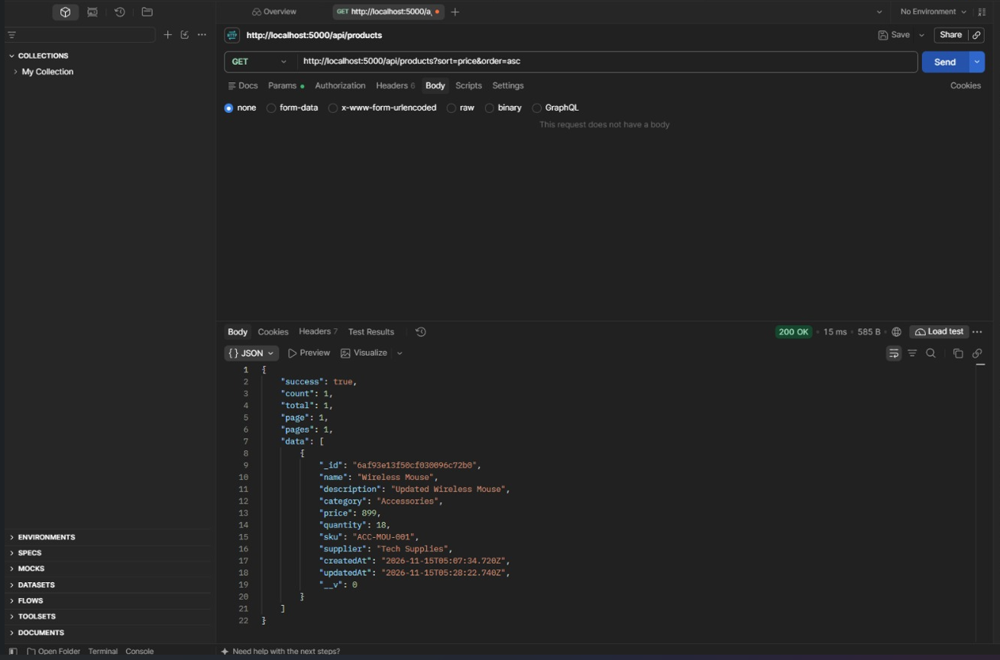 |
| **14 – Pagination** | 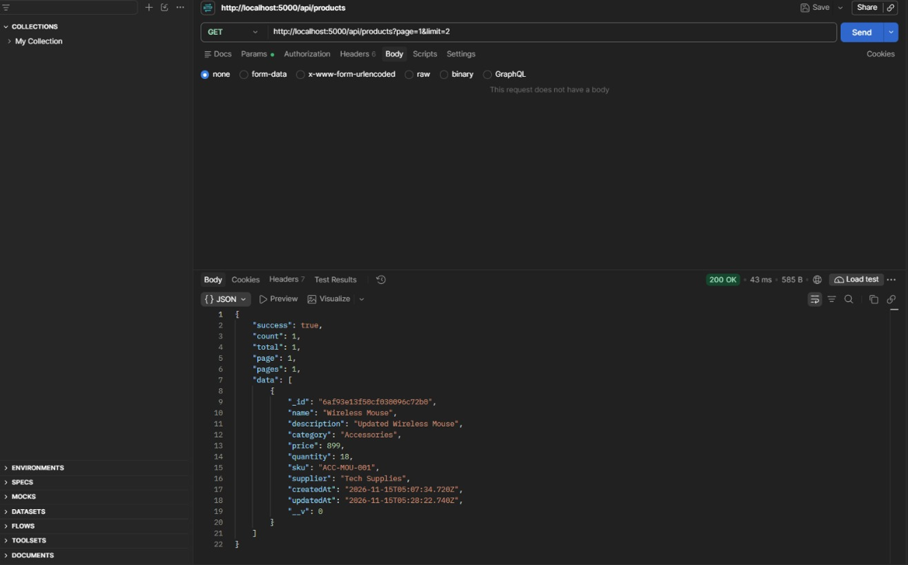 |
| **15 – Product Validation** | 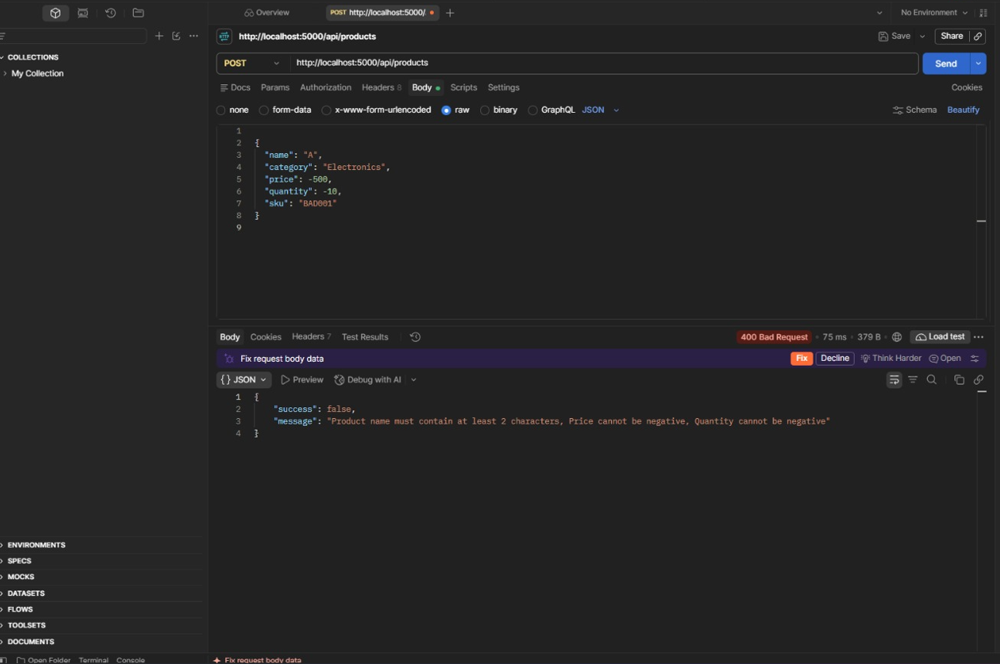 |
| **16 – Duplicate SKU Validation** | 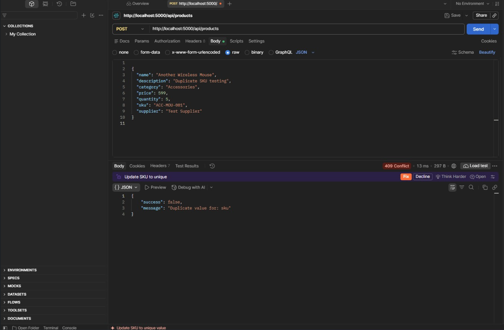 |

## 11. Testing Workflow

The following workflow was used to test the application:

1. Create multiple products and retrieve the product list.
2. Test product search and category filtering.
3. Verify price filtering, sorting, and pagination.
4. Retrieve individual products using their IDs.
5. Update existing product information.
6. Test stock replenishment and sales operations.
7. Verify stock validation and product deletion.
8. Generate low-stock and category-wise reports.
9. Test invalid product data and duplicate SKU handling.

## 12. Error Handling and Validation

The application includes centralized error handling to maintain consistent API responses.

The following cases are handled:

- Invalid product data.
- Duplicate SKU entries.
- Invalid MongoDB ObjectIds.
- Product not found.
- Invalid API routes.
- Database and server errors.

Errors are returned in JSON format with appropriate HTTP status codes.

## 13. Project Information

- Backend-only application developed using Node.js and Express.js.
- MongoDB is used for persistent data storage.
- Mongoose handles database schemas and validation.
- The project follows a modular architecture using routes, controllers, models, and middleware.
- Postman is used to test API functionality and responses.

---

## 14. Submission Details

| Particulars | Details |
|---|---|
| **Submitted By** | Aryan Kumar |
| **Roll Number** | 2501010043 |
| **Course** | Web Development III |
| **Assignment** | Assignment 3 |
| **Unit** | Unit 3 |
